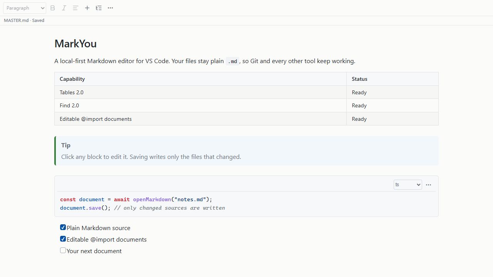

<p align="center"></p>

<h1 align="center">MarkYou</h1>

<p align="center"><strong>Write Markdown like a document. Keep plain <code>.md</code> files.</strong><br>
A local-first, click-to-edit Markdown editor for VS Code — with editable multi-file documents, offline PDF export and no account.</p>

<p align="center">
  <strong>English</strong> ·
  <a href="https://github.com/singerawei/markyou/blob/main/README.zh-CN.md">简体中文</a> ·
  <a href="https://github.com/singerawei/markyou/blob/main/README.ja.md">日本語</a> ·
  <a href="https://github.com/singerawei/markyou/blob/main/README.ko.md">한국어</a> ·
  <a href="https://github.com/singerawei/markyou/blob/main/README.es.md">Español</a> ·
  <a href="https://github.com/singerawei/markyou/blob/main/README.fr.md">Français</a> ·
  <a href="https://github.com/singerawei/markyou/blob/main/README.de.md">Deutsch</a> ·
  <a href="https://github.com/singerawei/markyou/blob/main/README.ru.md">Русский</a>
</p>

<p align="center">
  <a href="https://marketplace.visualstudio.com/items?itemName=singeraw.markyou"></a>
  
  
  
</p>

<p align="center"></p>

MarkYou lets you edit Markdown as a rendered document inside VS Code. Click a paragraph, update a table, or edit an included chapter; save your work as ordinary `.md` files that you can keep using with Git and other Markdown tools.

## What you can do

| Feature | What it helps you do |
| --- | --- |
| **Edit in place** | Click headings, paragraphs, lists, task lists and quotes to write directly in the document. |
| **Work with tables** | Insert tables, add or remove rows and columns, set alignment, paste tables from spreadsheets, and copy as TSV or Markdown. |
| **Combine Markdown files** | Use `@import` to bring chapters into one view. Edit included sections in place and save changes back to their own files. |
| **Write technical documents** | Render code with syntax highlighting, KaTeX math, Mermaid diagrams, footnotes, callouts, a table of contents and frontmatter. |
| **Find and replace** | Search visible text or Markdown source, navigate individual matches, and review the scope before replacing across files. |
| **Add images** | Paste screenshots, drop image files, or edit image properties. Local images are stored alongside your document. |
| **Export your work** | Export PDF with paper, margin, header, footer and page-number settings, or export a complete Markdown document with included chapters and local resources. |
| **Read comfortably** | Adjust text size and reading width, use focus mode, or switch a document to read-only. The source and save status stay visible. |

Your files stay local. No account is required, and there is no telemetry. Mermaid and PDF export use your installed Microsoft Edge or Google Chrome. If neither is available, MarkYou downloads an engine on first use and reuses it for later offline use. Remote images need a network connection.

## Install

**Requires Windows x64 and VS Code 1.100 or newer.** The current version is a preview.

1. Open [MarkYou in the VS Code Marketplace](https://marketplace.visualstudio.com/items?itemName=singeraw.markyou).
2. Choose **Install Pre-Release Version** in VS Code.
3. Right-click a `.md` file and choose **Open With… → MarkYou**.

You can also download the Windows x64 `.vsix` from [GitHub Releases](https://github.com/singerawei/markyou/releases), then choose **Extensions → … → Install from VSIX…** in VS Code. The extension does not bundle a browser. If an engine is needed, its download shows progress, can be cancelled, and is cached separately from the extension. A failed download can be retried.

## Start writing

1. Click a paragraph or heading to edit it. Select text to apply formatting, or use **Insert** to add a block.
2. Press `Ctrl+S` to save. The status strip shows the source file and whether it has unsaved changes.
3. Use `Ctrl+F` to find text and `Ctrl+Shift+O` to navigate the outline.
4. Choose **More → Export PDF** to export, or **More → Export complete Markdown…** to combine included chapters into a portable document.

To edit several adjacent blocks with one text selection, choose **More → Block actions → Edit continuous section**. Sections stay within one source file; included files and complex blocks have separate editing boundaries.

## Bring chapters together

Keep chapters in separate files and assemble them with relative paths:

```markdown
# Project handbook

@import "./chapters/overview.md"
@import "./chapters/setup.md"
@import "./chapters/reference.md"
```

The chapters appear in one document. Clicking an included section edits its original file, and saving writes only the files that changed. Nested and repeated includes are supported. Use the Include manager to inspect sources, change paths and reorder chapters.

**Save As Copy** copies the root file and keeps you in the current document. Keep the copy in the same folder to preserve relative paths. To produce one document with all chapters expanded, use **Export complete Markdown…**.

## Markdown support

- Headings, paragraphs, emphasis, strikethrough, code, quotes, lists and task lists.
- GFM tables, links, images and safe HTML.
- KaTeX inline and block math, Mermaid diagrams and syntax-highlighted code.
- Footnotes, reference links, definition lists, GitHub alerts and Obsidian callouts.
- Table of contents, wiki links, frontmatter, highlights, subscript and superscript.

For complex syntax, open the block editor to edit its Markdown with a preview. Unsupported syntax is preserved in the source file.

## Keyboard shortcuts

| Action | Shortcut |
| --- | --- |
| Save | `Ctrl+S` |
| Save As Copy | `Ctrl+Shift+S` |
| Find | `Ctrl+F` |
| Outline / Navigate | `Ctrl+Shift+O` |
| Insert | `Ctrl+Alt+I` |
| Focus mode | `Ctrl+Alt+F` |
| Hide toolbar | `Ctrl+Alt+T` |
| Help | `Ctrl+Alt+H` |

You can change these in VS Code's **Keyboard Shortcuts**. Open **MarkYou: Help** for more actions.

## Before you use it

- This version supports local `.md` files on Windows x64. Remote and virtual file systems are not supported.
- Markdown tables keep their first row as the header and do not support merged cells.
- Tables with more than 200 data rows or 5,000 cells use a read-only preview with paginated browsing and search. Use **Edit in Text Editor** to change them. Oversized prose and code blocks also offer the text editor.
- Wiki embeds such as `![[Page]]` appear as clickable cards.

Found a problem or have a suggestion? [Open an issue on GitHub](https://github.com/singerawei/markyou/issues).

## License

MIT. See [THIRD_PARTY_NOTICES.md](https://github.com/singerawei/markyou/blob/main/THIRD_PARTY_NOTICES.md) for dependency and Chromium licenses.
