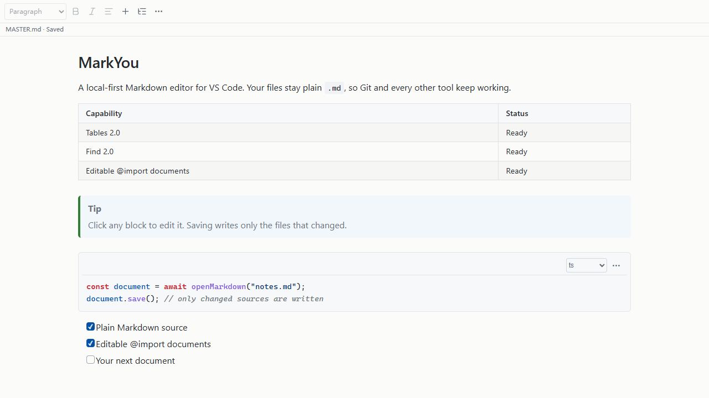

<p align="center"></p>

<h1 align="center">MarkYou</h1>

<p align="center"><strong>Локальный редактор Markdown для VS Code.</strong><br>
Щёлкните по любому блоку, чтобы отредактировать его на месте, а обычные файлы <code>.md</code> останутся единственным источником истины.</p>

<p align="center">
  <a href="https://github.com/singerawei/markyou/blob/main/README.md">English</a> ·
  <a href="https://github.com/singerawei/markyou/blob/main/README.zh-CN.md">简体中文</a> ·
  <a href="https://github.com/singerawei/markyou/blob/main/README.ja.md">日本語</a> ·
  <a href="https://github.com/singerawei/markyou/blob/main/README.ko.md">한국어</a> ·
  <a href="https://github.com/singerawei/markyou/blob/main/README.es.md">Español</a> ·
  <a href="https://github.com/singerawei/markyou/blob/main/README.fr.md">Français</a> ·
  <a href="https://github.com/singerawei/markyou/blob/main/README.de.md">Deutsch</a> ·
  <strong>Русский</strong>
</p>

<p align="center">
  <a href="https://marketplace.visualstudio.com/items?itemName=singeraw.markyou"></a>
  
  
  
</p>

<p align="center"></p>

MarkYou превращает обычные файлы `.md` в документ, который можно редактировать щелчком мыши прямо в VS Code. Ваши файлы остаются единственным источником истины: при каждом сохранении Markdown записывается обратно в файл, которому принадлежит содержимое, поэтому Git, текстовый редактор и любые другие инструменты Markdown продолжают работать.

Он создан для документов, которые растут. Объединяйте несколько файлов в один непрерывный документ с помощью `@import`, редактируйте включённые разделы на месте и сохраняйте только те исходные файлы, которые действительно изменились. Без аккаунта, базы данных, телеметрии и браузера.

## Чем он отличается

- **Markdown на входе, Markdown на выходе.** Никакого проприетарного формата или скрытой базы данных. Отрисованный документ и исходный файл всегда синхронизированы.
- **Редактируемые Include.** Импортируйте много файлов в одно представление; правки возвращаются в нужный исходный файл, включая вложенные и повторные импорты.
- **Рендеринг, а не замена.** Сложные блоки остаются отрисованными во время редактирования и никогда не превращаются в обычные текстовые области.
- **Локальность прежде всего.** Без телеметрии и входа в систему. Единственный сетевой трафик — удалённые изображения в документе.
- **Комфорт при больших объёмах.** Большие документы загружаются постепенно и отрисовываются рядом с областью просмотра; для огромных блоков используется встроенный редактор.

## Возможности

- **Редактирование по щелчку** — щёлкните по абзацу, заголовку, списку, таблице, списку задач, цитате, блоку кода или ссылке и редактируйте на месте.
- **Богатый Markdown** — таблицы GFM, списки задач, математика, сноски, оповещения и callouts, admonitions, списки определений, TOC, вики-ссылки, выделение, нижний/верхний индекс, эмодзи, frontmatter и безопасное подмножество HTML.
- **Навигация** — Find и Outline используют одну панель, следуют за прокруткой и могут закрепляться для каждого документа.
- **Диаграммы Mermaid** — отрисовываются локально и кэшируются; копирование, редактирование, масштабирование и экспорт в SVG/PNG.
- **Экспорт в PDF** — размер бумаги, поля, размер шрифта, колонтитулы, номера страниц и разрывы перед H1. Несохранённые правки включаются.
- **Чтение с учётом темы** — поддерживаются светлая, тёмная и высококонтрастная темы VS Code.
- **Управление с клавиатуры** — каждое частое действие является командой VS Code и может быть переназначено.
- **Для длинных документов** — постепенная загрузка, отрисовка в видимой области и выгрузка далёкого содержимого сохраняют отзывчивость больших файлов.

## Установка

**Требования:** Windows x64 и VS Code 1.100 или новее. Отдельно устанавливать Chrome или Edge не нужно.

Установите [предварительную версию MarkYou из Marketplace](https://marketplace.visualstudio.com/items?itemName=singeraw.markyou), выбрав **Install Pre-Release Version**. Также можно установить VSIX-файл:

1. Скачайте `markyou-win32-x64-1.1.2.vsix` со страницы [GitHub Releases](https://github.com/singerawei/markyou/releases).
2. В VS Code откройте **Расширения**, нажмите **… → Установить из VSIX…** и выберите файл.
3. Перезагрузите VS Code.
4. Щёлкните правой кнопкой по файлу `.md` и выберите **Открыть с помощью… → MarkYou**.

Mermaid и экспорт PDF сначала используют установленный Microsoft Edge или Google Chrome. Если они недоступны, движок загружается при первом использовании и сохраняется отдельно для дальнейшей работы без сети.

## Быстрый старт

1. **Откройте** файл `.md` через **Открыть с помощью… → MarkYou**.
2. **Редактируйте**, щёлкая по любому блоку. `Ctrl/Cmd+S` сохраняет, `Ctrl/Cmd+Shift+S` сохраняет под новым именем.
3. **Объедините** несколько файлов в одном представлении:

   ```markdown
   # Проектирование системы

   @import "./product/overview.md"
   @import "./architecture/system.md"
   @import "./features/payment.md"
   ```

   Редактируйте отрисованные разделы напрямую; при сохранении записываются только изменённые исходные файлы.
4. **Перемещайтесь** с помощью `Ctrl/Cmd+Shift+O`, вставляйте блоки через `Ctrl/Cmd+Alt+I`, экспортируйте через **More → Export PDF**.

## Поддержка Markdown

| Синтаксис | Редактирование |
| --- | --- |
| Заголовки, абзацы, выделение, код, цитаты, списки и разделители CommonMark | ✅ На месте |
| Таблицы GFM, выравнивание, списки задач, зачёркивание, автоматические ссылки | ✅ На месте |
| Выделение `==текст==`, нижний/верхний индекс, эмодзи | ✅ На месте |
| Безопасный HTML (`kbd`, `mark`, `details`, `sub`, `sup`, …) | ✅ Отрисованный contenteditable, очищенный |
| Математика `$...$`, `$$...$$` | ✅ KaTeX, блочный редактор с живым предпросмотром |
| Сноски, ссылки-определения, списки определений, аббревиатуры | ✅ Отрисовка, блочный редактор с живым предпросмотром |
| GitHub Alerts, Obsidian Callouts, admonitions | ✅ Отрисовка, свои заголовки, сворачивание |
| TOC, вики-ссылки, комментарии Obsidian, frontmatter | ✅ Отрисовка |
| Mermaid | ✅ Локальная отрисовка |
| Удалённые изображения | ✅ Загружаются при открытии; скачиваются для PDF |

Неподдерживаемый синтаксис сохраняется, а не уплощается.

## Горячие клавиши

| Действие | Windows / Linux | macOS |
| --- | --- | --- |
| Сохранить / Сохранить как | `Ctrl+S` / `Ctrl+Shift+S` | `Cmd+S` / `Cmd+Shift+S` |
| Найти | `Ctrl+F` | `Cmd+F` |
| Структура / Навигация | `Ctrl+Shift+O` | `Cmd+Shift+O` |
| Вставить | `Ctrl+Alt+I` | `Cmd+Alt+I` |
| Режим фокусировки | `Ctrl+Alt+F` | `Cmd+Alt+F` |
| Скрыть панель инструментов | `Ctrl+Alt+T` | `Cmd+Alt+T` |
| Справка | `?` или `Ctrl+Alt+H` | `?` или `Cmd+Alt+H` |

Все сочетания являются командами VS Code и могут быть переназначены. Полный список и конфликты с хостом приведены в **MarkYou: Help**.

## Полезно знать

- Поддерживаются только локальные файлы `.md`. Удалённые и виртуальные файловые системы, облачная синхронизация и аккаунты не входят в область поддержки.
- **Сохранить как** должен оставаться в той же папке, чтобы относительные Include продолжали работать.
- Слишком большие блоки открываются в текстовом редакторе: код свыше 128 КиБ, текст свыше 16 КиБ или таблицы свыше 200 строк.
- Вики-вставки (`![[Page]]`) открываются как кликабельные карточки, а не как полные трансклюзии.
- Предварительная версия доступна для Windows x64.

## Лицензия

MIT. Лицензии сторонних зависимостей и Chromium перечислены в [THIRD_PARTY_NOTICES.md](https://github.com/singerawei/markyou/blob/main/THIRD_PARTY_NOTICES.md).
