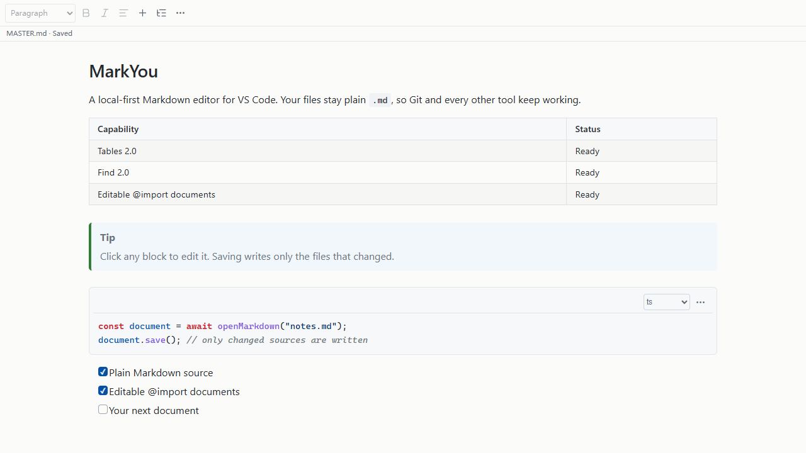

<p align="center"></p>

<h1 align="center">MarkYou</h1>

<p align="center"><strong>像写文档一样写 Markdown，文件仍然是普通 <code>.md</code>。</strong><br>
面向 VS Code 的本地优先、点击即编辑 Markdown 编辑器：可编辑多文件文档、离线 PDF 导出，无需账号。</p>

<p align="center">
  <a href="https://github.com/singerawei/markyou/blob/main/README.md">English</a> ·
  <strong>简体中文</strong> ·
  <a href="https://github.com/singerawei/markyou/blob/main/README.ja.md">日本語</a> ·
  <a href="https://github.com/singerawei/markyou/blob/main/README.ko.md">한국어</a> ·
  <a href="https://github.com/singerawei/markyou/blob/main/README.es.md">Español</a> ·
  <a href="https://github.com/singerawei/markyou/blob/main/README.fr.md">Français</a> ·
  <a href="https://github.com/singerawei/markyou/blob/main/README.de.md">Deutsch</a> ·
  <a href="https://github.com/singerawei/markyou/blob/main/README.ru.md">Русский</a>
</p>

<p align="center">
  <a href="https://marketplace.visualstudio.com/items?itemName=singeraw.markyou"></a>
  
  
  
</p>

<p align="center"></p>

MarkYou 让你在 VS Code 中直接编辑渲染后的 Markdown 文档。点击段落就能写作，表格可以直接修改，分散在多个文件中的章节也能放在一起编辑。保存后仍是普通 `.md` 文件，可以继续用 Git 管理，也能用其他 Markdown 工具打开。

## 能做什么

| 功能 | 使用方式 |
| --- | --- |
| **直接编辑文档** | 点击标题、段落、列表、任务项或引用即可编辑，选中文字就能调整格式。 |
| **编辑表格** | 插入表格、增删行列、设置对齐；从 Excel 等表格工具粘贴，也能复制为 TSV 或 Markdown。 |
| **组合多个文件** | 用 `@import` 把章节放到同一个视图中，直接编辑引入的内容，修改保存回各自的源文件。 |
| **编写技术文档** | 支持代码高亮、KaTeX 数学公式、Mermaid 图表、脚注、提示块、目录和 Frontmatter。 |
| **查找与替换** | 搜索可见文字或 Markdown 源码，逐个定位命中；跨文件替换前可以查看范围。 |
| **插入图片** | 粘贴截图、拖入图片文件、修改图片属性；本地图片保存在文档附近。 |
| **导出文档** | 导出 PDF 时设置纸张、边距、页眉页脚和页码；也能导出展开全部章节、附带本地资源的完整 Markdown。 |
| **调整阅读体验** | 设置字号、阅读宽度和专注模式，或把文档切换为只读；随时查看当前来源和保存状态。 |

文件保存在本地，无需账号，不收集遥测数据。Mermaid 渲染和 PDF 导出优先使用本机的 Microsoft Edge 或 Google Chrome；两者都不可用时，首次使用会下载渲染引擎并缓存，之后可离线复用。文档中的远程图片需要联网加载。

## 安装

**支持 Windows x64，要求 VS Code 1.100 或更高版本。当前版本为预览版。**

1. 打开 [VS Code Marketplace 中的 MarkYou](https://marketplace.visualstudio.com/items?itemName=singeraw.markyou)。
2. 在 VS Code 的扩展页面选择 **安装预发行版本（Install Pre-Release Version）**。
3. 右键 `.md` 文件，选择 **打开方式… → MarkYou**。

也可以从 [GitHub Releases](https://github.com/singerawei/markyou/releases) 下载 Windows x64 的 `.vsix` 文件，在 VS Code 中选择 **扩展 → … → 从 VSIX 安装…**。安装包不再内置浏览器。需要下载引擎时会显示进度，可取消；引擎单独缓存，下载失败后可以重试。

## 开始写作

1. 点击段落或标题进行编辑。选中文字可以调整格式，通过 **插入** 添加新内容块。
2. 按 `Ctrl+S` 保存，状态条会显示当前源文件及是否有未保存的修改。
3. 按 `Ctrl+F` 查找文字，按 `Ctrl+Shift+O` 打开大纲导航。
4. 在 **更多 → 导出 PDF** 中导出 PDF；需要合并所有引入章节时，选择 **更多 → 导出完整 Markdown…**。

需要跨相邻段落选字、剪切或删除时，可使用 **更多 → 块操作 → 编辑同源连续章节**。连续编辑限于同一个源文件；引入的文件和复杂内容块有各自的编辑边界。

## 把多个章节放在一起

章节可以分别保存在不同文件中，再通过相对路径组合：

```markdown
# 项目手册

@import "./chapters/overview.md"
@import "./chapters/setup.md"
@import "./chapters/reference.md"
```

这些章节会显示在同一篇文档里。点击引入的内容即可编辑原文件，保存时只写回发生变化的文件。支持嵌套引入和重复引入，也可以通过 Include 管理器查看来源、修改路径和调整章节顺序。

**另存为副本** 只复制根文件，编辑器仍停留在当前文档；副本需要放在同一目录中，以保持相对路径有效。若要生成包含全部章节的单一文档，请使用 **导出完整 Markdown…**。

## 支持的 Markdown 内容

- 标题、段落、粗体、斜体、删除线、代码、引用、列表和任务列表。
- GFM 表格、链接、图片和安全 HTML。
- KaTeX 行内及块级公式、Mermaid 图表、带语法高亮的代码块。
- 脚注、引用式链接、定义列表、GitHub Alerts 和 Obsidian Callouts。
- 目录、Wiki 链接、Frontmatter、高亮、上标和下标。

复杂语法可以在块编辑器中修改 Markdown 并查看预览；不支持的语法会保留在源文件中。

## 常用快捷键

| 操作 | 快捷键 |
| --- | --- |
| 保存 | `Ctrl+S` |
| 另存为副本 | `Ctrl+Shift+S` |
| 查找 | `Ctrl+F` |
| 大纲 / 导航 | `Ctrl+Shift+O` |
| 插入 | `Ctrl+Alt+I` |
| 专注模式 | `Ctrl+Alt+F` |
| 隐藏工具栏 | `Ctrl+Alt+T` |
| 帮助 | `Ctrl+Alt+H` |

可以在 VS Code 的 **键盘快捷方式** 中修改这些按键，更多操作见 **MarkYou: Help**。

## 使用前了解

- 当前支持 Windows x64 上的本地 `.md` 文件，暂不支持远程或虚拟文件系统。
- Markdown 表格的第一行为表头，不支持合并单元格。
- 超过 200 个数据行或 5,000 个单元格的表格提供只读预览、分页浏览和搜索，可通过 **在文本编辑器中编辑** 修改。超大的正文块和代码块也会提供文本编辑器入口。
- Wiki 嵌入（如 `![[Page]]`）会显示为可点击的卡片。

遇到问题或有功能建议，可以在 [GitHub Issues](https://github.com/singerawei/markyou/issues) 反馈。

## 许可证

MIT。第三方依赖与 Chromium 许可见 [THIRD_PARTY_NOTICES.md](https://github.com/singerawei/markyou/blob/main/THIRD_PARTY_NOTICES.md)。
